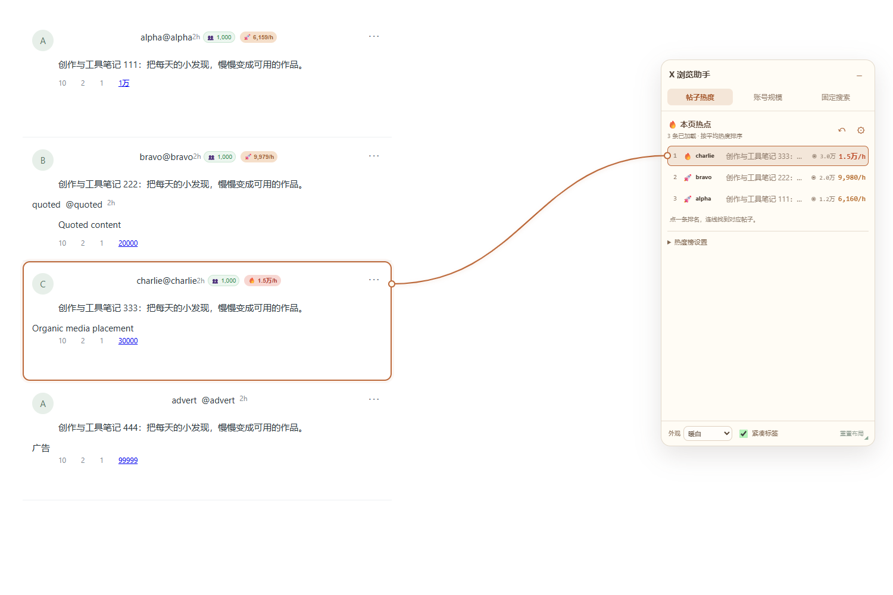

# X 浏览助手

**免费开源的 X / Twitter 浏览增强插件。看帖子热度、找本页热点、了解账号、保存搜索，让日常浏览更顺手。**

适用于桌面 **Chrome / Microsoft Edge**，采用 **MIT License**。当前版本 **1.8.3**。

[下载源码 ZIP](https://github.com/wanhangyu/x-browser-helper/archive/refs/heads/main.zip) · [安装方法](#安装方法) · [使用说明](#开始使用) · [隐私说明](PRIVACY.md) · [更新记录](CHANGELOG.md) · [反馈问题](https://github.com/wanhangyu/x-browser-helper/issues)

## 能帮你做什么

- **边看边判断热度**：在帖子发布时间后显示作者粉丝数和平均浏览热度，悬停可看更多指标。
- **从当前页面找热点**：把已加载帖子按平均热度排列，点击榜单定位原帖，并用高亮和连线帮助寻找。
- **把常用搜索存下来**：保存关键词、时间范围等条件，支持分组、置顶与滚动日期。
- **让阅读界面更清爽**：按需调整侧栏、通知数字和额外作者信息，面板与缩小标签都能拖动。
- **按需了解作者**：可开启作者简介、中文翻译与手动关注入口，默认保持简洁。

插件本身免费使用，源代码公开，功能无需购买授权。你可以阅读源码、提出建议，或按项目许可证自行修改。可选在线翻译由你自行选择服务；其中自定义模型服务可能按服务商规则收费。

## 界面预览

以下截图使用**虚构账号与测试帖子**，用于展示界面和交互，不代表真实账号数据或效果承诺。

**展开面板：帖子热度、本页榜单、点击定位与连线。**



**收起状态：页面仅保留一个可拖动的“X 助手”标签。**


## 功能一览

| 功能 | 具体用法 |
| --- | --- |
| 帖子热度 | 查看从发布至今的平均浏览量 / 小时；悬停查看浏览量、互动数据及参考指数 |
| 本页热点榜 | 汇总当前页面已加载的帖子，按平均热度排序，支持设置显示条数 |
| 定位原帖 | 点击排名后滚动到对应帖子，高亮并显示连线，可返回定位前的位置 |
| 账号粉丝数 | 默认显示在头部发布时间后面；悬停可查看完整计数和读取时间 |
| 时间与热度筛选 | 按发布时间、平均热度或累计浏览量筛选，支持长文阈值和预设 |
| 榜单显示列 | 按需显示排名、等级、作者、正文预览、浏览量、流速，支持调整顺序 |
| 固定搜索 | 保存高级搜索，按当前日期生成最近 N 天条件，支持分组和置顶 |
| 自由布局 | 面板可移动和调整大小；减号收起、点击缩小标签展开 |
| 位置记忆 | 缩小标签可自由拖动、左右吸附；标签和完整面板分别记住位置 |
| 阅读设置 | 按需隐藏左右侧栏或通知未读数字，支持暖白、暗色及跟随 X 外观 |
| 可选简介翻译 | 可开启额外作者简介，支持浏览器本机翻译、Google 及自定义兼容接口 |
| 可选手动关注 | 开启额外作者信息后，点击关注入口复用 X 原生菜单并观察返回结果 |

## 安装方法

当前通过浏览器的“加载已解压的扩展程序”安装。

1. [下载本仓库 ZIP](https://github.com/wanhangyu/x-browser-helper/archive/refs/heads/main.zip)，解压到一个固定文件夹。
2. 打开扩展管理页：Chrome 输入 `chrome://extensions`，Edge 输入 `edge://extensions`。
3. 开启页面上的**开发者模式**。
4. 点击**加载已解压的扩展程序**。
5. 选择解压后的 **`extension` 文件夹**，这个文件夹里应直接能看到 `manifest.json`。
6. 打开或刷新 [x.com/home](https://x.com/home)，点击页面侧边的 **X 助手** 标签。

```text
x-browser-helper-main/
├─ extension/            ← 安装时选择这个文件夹
│  ├─ manifest.json
│  └─ ...
├─ README.md
└─ ...
```

浏览器使用插件的过程不需要安装 Node.js、Python 或开发依赖。扩展文件夹需要保留在原位置，方便浏览器以后继续加载。

### 已安装用户如何更新

1. 下载新版本，把 `extension` 内文件覆盖到**浏览器原来加载的文件夹**。
2. 在扩展管理页找到 **X 浏览助手**，点击**重新加载**。
3. 刷新 X 页面。

沿用原文件夹和当前浏览器配置，可保留已有固定搜索与设置。更新通常无需卸载；卸载可能清除本地数据。下载包的名称可以变化，浏览器实际加载的文件夹路径应保持稳定。

## 开始使用

### 先看帖子，再看本页榜单

帖子头部默认按以下顺序展示信息：

**姓名 · 账号 · 发布时间 · 粉丝数 · 热度**

打开助手的“帖子热度”页，可以查看当前页面已加载内容的排名。点击一条排名即可定位帖子；悬停热度标签可查看详细指标。滚动加载更多帖子后，榜单会继续更新。

齿轮或“热度榜设置”中可以调整显示条数、热度阈值、显示列及标签位置，也可以选择时间范围和筛选预设。

### 热度是怎样计算的

**平均热度 = 累计浏览量 ÷ 发布至今的小时数。**

例如，一条发布 2 小时、累计 10,000 次浏览的帖子，平均热度约为 **5,000/h**。时间继续过去，即使浏览量不变，平均热度也会下降。

- 这是发布以来的平均值，不能当作最近一小时新增浏览量。
- “本页热点”统计当前页面已加载的内容，不能当作全 X 榜单。
- 🌱、🚀、🔥 根据设定阈值区分参考等级；可在设置里调整阈值。
- 未加载、隐藏或过期的数据会保留未知状态；刚发布的帖子可能需要等待足够样本。
- 互动率与参考指数受数据完整度影响，适合辅助浏览和比较。

### 保存常用搜索

在“固定搜索”页新建搜索，填写名称、关键词及需要的时间、点赞等条件，然后保存。可按用途分组，将常用项置顶。

“最近 N 天”使用打开搜索时的当前日期生成条件，适合反复查找近期内容。使用 X 搜索仍受其登录状态、搜索结果和平台限制影响。

### 面板和缩小标签

| 操作 | 结果 |
| --- | --- |
| 拖动面板标题 | 移动工作台；靠近左右边缘会对齐 |
| 拖动面板右下角 | 调整窗口大小 |
| 点击标题栏减号 | 收起为“X 助手”标签 |
| 点击缩小标签 | 回到收起前的面板位置和大小 |
| 拖动缩小标签 | 自由移动；靠近左右边缘吸附，也可上下调整 |
| 点击面板底部“重置布局” | 恢复默认位置和大小 |

标签位置与完整面板位置分别保存，再次收起和刷新页面后仍能记住。鼠标移出或悬停不会自动改变收放状态。面板和标签会避开滚动条；窗口变小时会限制在可见范围内。

缩小标签可用方向键微调，按住 Shift 可加大步长；Enter / 空格可展开。面板中的表单和按钮支持键盘操作。

### 按需显示作者简介与关注

**额外作者简介与关注按钮默认关闭。** 可以在助手“账号规模”页开启，也可从浏览器工具栏的插件弹窗中切换。

开启后，在有可用资料的帖子上显示额外简介行，可展开简介、查看账号自填所在地，并在条件允许时手动关注。关闭后移除插件额外添加的行，保留 X 原生资料与操作入口。

粉丝数来自 X 已加载的数据，缓存有有效期；缺失时可尝试悬停账号资料卡或打开主页后返回。账号所在地是账号自行填写的资料。

## 简介翻译

开启额外作者简介后，可在插件工具栏弹窗进入**简介翻译设置与接口测试**。

| 方式 | 配置与说明 |
| --- | --- |
| 浏览器本机翻译 | 默认选项；取决于浏览器能力和语言模型是否就绪，首次启用可能需要下载语言包 |
| Google 在线翻译 | 无需 API Key；属于可选在线服务，可能限流或暂时不可用 |
| Chat Completions 兼容接口 | 自行填写 HTTPS 地址、模型名称和 Key |
| Anthropic Messages 接口 | 自行填写服务地址、模型名称和 Key |
| Gemini 原生接口 | 自行填写服务地址、模型名称和 Key |

本机翻译不可用或翻译失败时保留原文；中文与中英混合简介通常保留原文。译文可切换回原文，更改服务后会清除旧译文。

选择在线服务后，待翻译的简介会发送给你选择的服务商；保存时按域名申请访问权限。**插件免费，自定义服务的调用费用由服务商决定。** 可使用设置页的虚构示例测试连接，再用于日常浏览。

## 数据与隐私

- 从 X 当前页面已收到的接口响应和可见元素读取数据。
- 固定搜索、外观、布局和粉丝缓存保存在当前浏览器本地。
- 简介、关系、帖子指标及译文在当前页面内存中处理，不写入持久账号缓存。
- 项目没有自建的数据上传或分析后台。
- 在线翻译为可选项，启用后的简介会发往所选服务；Key 保存在浏览器本地，由扩展后台使用。

基础权限为 `storage` 和 `activeTab`，运行站点为 `x.com`、`twitter.com` 与 `pro.x.com`。详细数据范围、可选域名权限和关注操作见 [隐私说明](PRIVACY.md)。

## 常见问题

### 安装时为什么提示找不到清单文件？

请选择直接包含 `manifest.json` 的 `extension` 文件夹，不要选择仓库最外层，也不要选择尚未解压的 ZIP。

### 更新后界面没有变化？

确认覆盖的是浏览器原来加载的目录，点“重新加载”，再刷新 X。可在扩展管理页核对版本号。

### 热度或粉丝为什么暂时不显示？

先确认开关已开启，等待 X 加载页面数据并继续滚动。粉丝、帖子指标和平台页面结构都可能影响显示；部分数据隐藏或尚未加载时无法显示完整指标。

### 榜单为什么只出现少量帖子？

榜单只统计当前页面已加载、可计算热度且符合当前时间筛选的帖子。可继续滚动加载，并检查时间范围和筛选设置。

### 为什么没有简介或关注按钮？

额外作者信息默认关闭。进入助手“账号规模”开启后，也需要 X 已提供该账号的有效资料和对应操作入口。

### 需要付费吗？

**X 浏览助手免费、开源，采用 MIT License。** 本地浏览、热度榜、搜索和布局等功能由插件提供。自选在线翻译服务是否收费，以相应服务商规则为准。

## 开发与验证

开发环境：Node.js 22+、Python 3.9+。Playwright 用于开发验收，不随扩展分发。

```sh
npm ci --ignore-scripts
npm run build
npm test
npx playwright install chromium
npm run test:browser
npm run package
```

Linux 首次准备浏览器时可运行 `npx playwright install --with-deps chromium`。也可将 `X_HELPER_BROWSER_PATH` 指向兼容的 Chrome / Edge 可执行文件；`HEADED=1` 可显示测试窗口。

- 运行源码：`extension/`。
- `content.bundle.js` 由 `core.js`、`dom.js` 和 `content.js` 按顺序生成，修改后需重新构建。
- `npm test` 检查合成文件、JavaScript 语法、版本、权限、许可与核心行为。
- 浏览器测试使用虚构数据和独立配置，覆盖指标匹配、引用隔离、广告排除、筛选、搜索、翻译、手动关注模拟和面板交互。
- `npm run package` 在 `dist/` 生成扩展 ZIP 和 SHA-256 校验文件。

```text
extension/       扩展运行文件与第三方许可
tests/           合成数据和浏览器回归
scripts/         构建、验证与打包
docs/images/     合成页面演示截图
.github/         自动检查流程
```

测试截图位于 `artifacts/screenshots/`。浏览器配置、测试输出、开发依赖和本地个人记录均不纳入源码提交。测试通过不能代表全部真实 X 界面或所有翻译服务都已实测；X 页面变化时可能需要更新适配。

## 参与改进

欢迎通过 [Issues](https://github.com/wanhangyu/x-browser-helper/issues) 反馈问题或提出建议，也欢迎提交改进代码。反馈时请附浏览器版本、插件版本和可复现步骤；截图或示例使用虚构数据，避免包含个人凭据。

提交前请阅读 [贡献说明](CONTRIBUTING.md)。

## 开源许可与致谢

本项目由 [万航宇](https://github.com/wanhangyu) 独立维护，采用 [MIT License](LICENSE)，免费开源。

部分翻译与关注组件适配自同为 MIT 许可的 [XpandMax](https://github.com/yiren-ai/xpandmax)。保留原始版权与许可证，实际适配文件和出处见 [第三方说明](THIRD_PARTY_NOTICES.md)。感谢原作者与开源社区。
